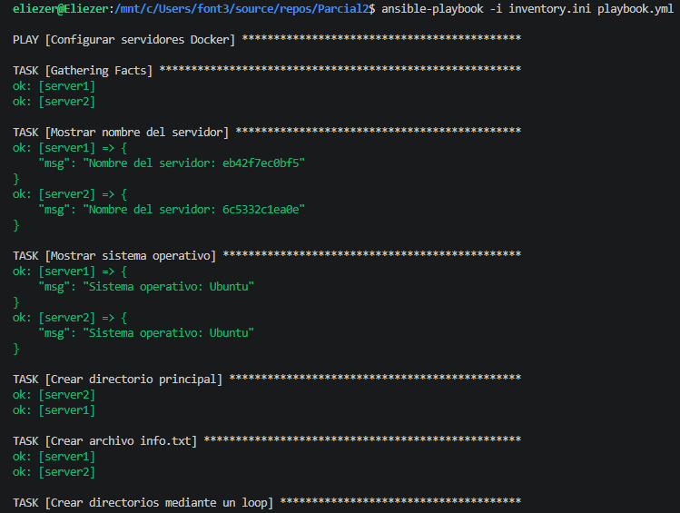
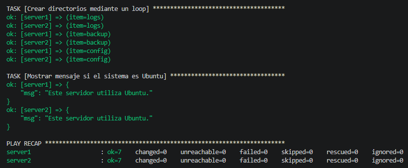

# Laboratorio Ansible - Parcial 2

## Objetivo

Implementar un laboratorio de automatización utilizando Ansible y Docker Compose, administrando dos servidores Ubuntu 24.04 mediante un Playbook.

## Tecnologías utilizadas

- Ansible 2.16.3
- Docker 29.8.2
- Docker Compose
- Ubuntu 24.04
- Python 3

## Estructura del proyecto

```text
Parcial2/
├── docker-compose.yml
├── inventory.ini
├── playbook.yml
└── README.md
```

## Iniciar los contenedores

```bash
docker compose up -d
```

Verificar los contenedores:

```bash
docker ps
```

## Verificar conexión con Ansible

```bash
ansible docker -i inventory.ini -m ping
```

## Ejecutar el Playbook

```bash
ansible-playbook -i inventory.ini playbook.yml
```

## Tareas realizadas

- Mostrar el nombre de cada servidor.
- Identificar el sistema operativo.
- Crear el directorio ansible-demo.
- Crear el archivo info.txt con información del servidor.
- Crear los directorios logs, backup y config mediante un loop.
- Mostrar un mensaje cuando el sistema operativo sea Ubuntu.

## Evidencia de ejecución

Agregar aquí una captura de pantalla de la ejecución exitosa del Playbook.



